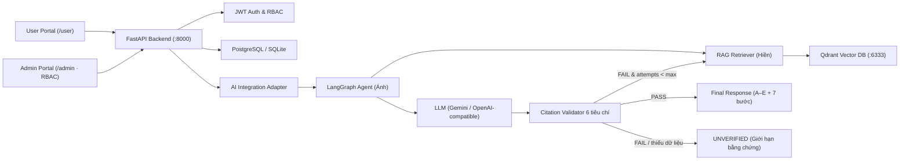
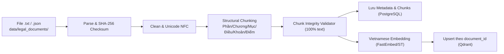
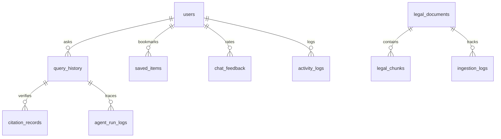

# LEGAL AI ASSISTANT — Kiến trúc, Hướng dẫn sử dụng & Bàn giao kỹ thuật

## 1. Sơ đồ kiến trúc tổng thể



## 2. Sơ đồ luồng dữ liệu Offline (RAG Ingestion Pipeline)



## 3. Sơ đồ Multi-Agent & Citation Validator (Self-Correction)

```mermaid
flowchart TD
    Q["1. Tiếp nhận câu hỏi"] --> QA["2. Phân tích câu hỏi"]
    QA --> DEC["3. Phân rã vấn đề pháp lý"]
    DEC --> RET["4. Tìm kiếm đa văn bản (Qdrant)"]
    RET --> ANA["5. Đối chiếu & Phân tích + Kiểm tra hiệu lực"]
    ANA --> VAL["6. Kiểm tra trích dẫn (6 tiêu chí)"]
    VAL -->|PASS| RES["7. Trả kết quả cấu trúc A–E"]
    VAL -->|FAIL & attempts < max| SC["Self-Correction: Mở rộng truy xuất Top-K"]
    SC --> RET
    VAL -->|Không đủ căn cứ / vượt max attempts| UNV["7. Trả kết quả UNVERIFIED + Nêu rõ giới hạn"]
```



## 4. Database Schema (PostgreSQL / SQLite)



## 5. Hướng dẫn sử dụng hai cổng giao diện

### 5.1. User Portal (`/user` hoặc `/`)
1. **Trang chủ:** Nhập câu hỏi trực tiếp, chọn lĩnh vực pháp luật hoặc tình huống mẫu trích từ `Bộ câu hỏi pháp luật.docx` (QUESTION DATASET, không đưa vào Qdrant).
2. **Trợ lý pháp luật:** Hội thoại nhiều lượt, tạo hội thoại mới, sao chép, lưu câu trả lời, gửi đánh giá chất lượng.
3. **Theo dõi quá trình xử lý:** Xem trạng thái thật của 7 bước từ Backend và nhật ký Self-Correction.
4. **Kết quả tra cứu:** Xem báo cáo 5 phần A–E (Kết luận, Phân tích tình huống, Căn cứ pháp lý có modal xem văn bản gốc, Kết quả kiểm chứng 6 tiêu chí, Giới hạn câu trả lời).
5. **Tra cứu văn bản pháp luật:** Tìm kiếm & lọc theo loại văn bản, cơ quan ban hành, tình trạng hiệu lực; xem điều khoản và lưu mục yêu thích.
6. **Lịch sử tra cứu:** Xem lại lịch sử, tiếp tục cuộc hội thoại cũ, xóa theo quyền.
7. **Văn bản đã lưu:** Quản lý văn bản yêu thích, điều khoản và câu trả lời đã lưu.
8. **Tài khoản:** Đăng nhập, đăng ký, cập nhật họ tên, đổi mật khẩu, đăng xuất.

### 5.2. Admin Portal (`/admin` — yêu cầu vai trò `admin`)
- Tài khoản quản trị mẫu: `admin@legalai.vn` / `Admin@123` (khuyến nghị đổi ngay khi triển khai).
1. **Dashboard:** Thống kê thật về văn bản, lượt tra cứu, citation, lỗi FAIL và sức khỏe dịch vụ.
2. **Quản lý văn bản:** Upload `.txt`/`.json`, thêm văn bản, sửa metadata, quét thư mục chống trùng SHA-256, xóa theo `document_id`.
3. **Quản lý dữ liệu RAG:** Theo dõi pipeline 6 bước, nạp lại văn bản, thử nghiệm Vector Search trực tiếp trên Qdrant.
4. **Theo dõi Agent:** Nhật ký từng lượt thực thi Agent, trạng thái 6 giai đoạn và lỗi xử lý.
5. **Citation Validator:** Báo cáo tổng hợp, lịch sử kiểm chứng và công cụ kiểm thử 6 tiêu chí trực tiếp.
6. **Testing Dashboard:** Kết quả chạy kiểm thử Pytest thực tế và bảng so sánh 4 phiên bản Model A–D.
7. **Người dùng & Phân quyền:** Đổi vai trò `user`/`admin`, khóa/mở khóa tài khoản, xem nhật ký hoạt động.
8. **Cấu hình hệ thống:** Đổi chế độ `DEMO`/`LIVE`, cấu hình model LLM và số lượt Self-Correction (API key luôn được che ẩn).

## 6. Hướng dẫn triển khai Docker Compose

```bash
# 1. Tạo file môi trường từ mẫu
cp .env.example .env

# 2. Khởi chạy toàn bộ hệ thống (PostgreSQL + Qdrant + FastAPI Backend + Next.js Frontend)
docker compose up --build -d

# 3. Kiểm tra trạng thái container & healthcheck
docker compose ps
curl http://127.0.0.1:8000/health

# 4. Dừng hệ thống (giữ nguyên dữ liệu volumes postgres_data & qdrant_data)
docker compose stop

# 5. Khởi động lại và kiểm tra dữ liệu vẫn còn nguyên
docker compose up -d
```
